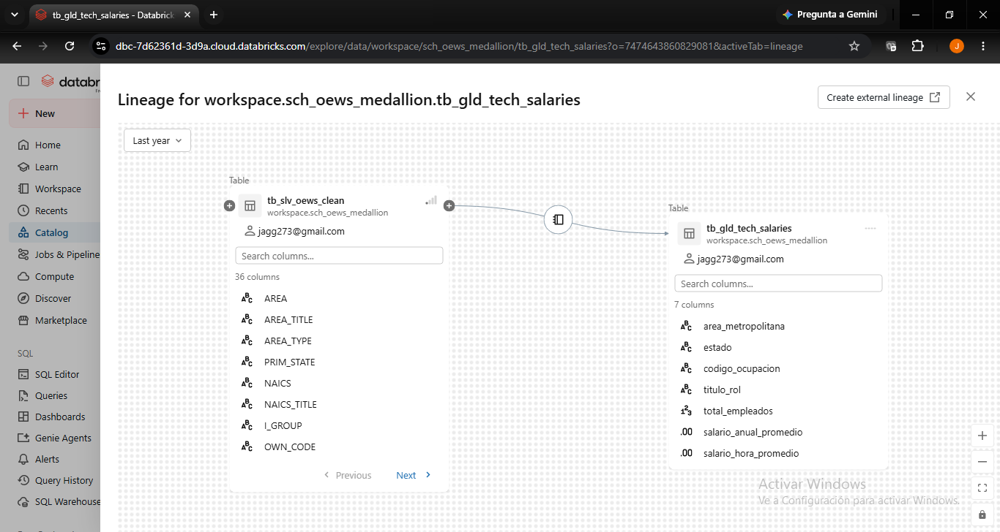

markdown
# 🏛️ Gobierno de Datos y Arquitectura Medallion: Análisis del Mercado Laboral (OEWS 2025)

## 📌 Resumen del Proyecto
Este proyecto implementa una arquitectura moderna de ingeniería y **Gobierno de Datos** de extremo a extremo utilizando **Databricks** y **Unity Catalog**. A partir de los datos oficiales de estadísticas salariales y de empleo de los Estados Unidos (*Occupational Employment and Wage Statistics - OEWS, Mayo 2025* publicados por el BLS), se diseñó un flujo automatizado bajo la **Arquitectura Medallion (Bronze, Silver, Gold)** para garantizar la calidad, granularidad, trazabilidad y disponibilidad de la información para la toma de decisiones ejecutivas.

---

## 🏗️ Arquitectura de la Solución (Medallion Architecture)

El flujo de datos transforma más de **150,000 registros crudos** en indicadores clave de negocio (KPIs) asegurando la integridad en cada etapa:

1. **🥉 Capa Bronze (`tb_brz_oews_2025`):** Zona de aterrizaje (*Landing Zone*). Almacena los datos crudos originales en formato Delta Lake sin alteraciones para garantizar la inmutabilidad y permitir futuras auditorías. Documentada mediante metadatos asistidos por IA en Unity Catalog.
2. **🥈 Capa Silver (`tb_slv_oews_clean` & `tb_qua_oews_errors`):** Capa de limpieza, estandarización y control de calidad (*Data Quality*). Se aplican reglas estrictas de granularidad y tipado numérico. Los registros que no cumplen las políticas de gobierno son aislados automáticamente en una **tabla de cuarentena**.
3. **🥇 Capa Gold (`tb_gld_tech_salaries` & `tb_gld_state_summary`):** Modelos analíticos agregados y optimizados para consumo directo de negocio, enfocados en inteligencia salarial para roles tecnológicos (código SOC `15-xxxx`) y resúmenes ejecutivos por estado.

---

## 🛡️ Pilares de Gobierno de Datos Implementados

### 1. Estándar de Nomenclatura (*Naming Conventions*)
Todos los artefactos del entorno siguen una convención estricta basada en **Notación Húngara + formato `snake_case` en minúsculas**.
* **Justificación técnica:** Previene fallos de sensibilidad de mayúsculas (*case-sensitivity*) entre motores de Spark, SQL y almacenamiento subyacente, elimina errores de sintaxis por espacios y permite identificar la capa arquitectónica de cada objeto de un solo vistazo.

| Artefacto | Prefijo | Nombre en el Proyecto | Capa / Propósito |
| :--- | :--- | :--- | :--- |
| **Esquema (Catalog)** | `sch_` | `sch_oews_medallion` | Contenedor gobernado en Unity Catalog |
| **Notebook** | `nb_` | `nb_silver_data_quality` | Motor de reglas de calidad y cuarentena |
| **Notebook** | `nb_` | `nb_gold_business_kpis` | Agregaciones y métricas de negocio |
| **Tabla Bronze** | `tb_brz_` | `tb_brz_oews_2025` | Datos crudos inmutables |
| **Tabla Silver** | `tb_slv_` | `tb_slv_oews_clean` | Datos limpios, tipados y auditados |
| **Tabla Cuarentena** | `tb_qua_` | `tb_qua_oews_errors` | Aislamiento de registros corruptos o subtotales |
| **Tabla Gold** | `tb_gld_` | `tb_gld_tech_salaries` | Inteligencia salarial del sector TI y Datos |
| **Tabla Gold** | `tb_gld_` | `tb_gld_state_summary` | Indicadores macroeconómicos por estado |

### 2. Control de Calidad, Granularidad y Tabla de Cuarentena (*Data Quality*)
Mediante programación defensiva en **PySpark**, se establecieron reglas de validación antes de promover los datos a la capa Silver:
* **Consistencia de Granularidad:** Se filtraron exclusivamente las ocupaciones de nivel detallado (`O_GROUP == 'detailed'`), aislando filas de totales generales (`total`) y grupos mayores (`major`) para evitar duplicidad en las sumas de empleo.
* **Integridad Numérica y Manejo de Excepciones:** Se descartaron registros con valores confidenciales o faltantes (`*`, `#`, `**`) en salario anual y empleo total, y se utilizó `try_cast` para manejar tolerancia a fallos en salarios por hora.
* **Auditoría Temporal:** Se incorporó la columna de metadatos `fecha_auditoria` (`current_timestamp`) para rastrear el momento exacto de validación de cada registro.

#### 📊 Resultados de Auditoría de Calidad:
* **Total de registros ingesta (Bronze):** `150,023` (100%)
* **Registros aprobados y tipados (Silver):** `136,276` (**90.84%**)
* **Registros aislados en Cuarentena:** `13,747` (**9.16%**)

### 3. Trazabilidad y Linaje de Datos (*Data Lineage*)
A través de **Unity Catalog**, se garantiza la trazabilidad completa de extremo a extremo (*end-to-end lineage*), permitiendo auditar qué notebooks transforman cada tabla y qué impacto tendría un cambio en la fuente original.

---

## 💡 Principales Hallazgos de Negocio (Insights)

Al consultar la capa Gold enfocada en roles de tecnología y ciencia de datos (`tb_gld_tech_salaries`), se identificaron los puestos mejor remunerados por área metropolitana:
1. **Computer and Information Research Scientists:** Salario anual promedio de **$223,160 USD** ($107.29/hora).
2. **Software Developers:** Salario anual promedio de **$221,710 USD** (con un volumen de 87,350 empleos en el área líder).
3. **Data Scientists:** Salario anual promedio de **$212,760 USD** ($102.29/hora).

---

## 🛠️ Stack Tecnológico
* **Plataforma Cloud:** Databricks (Free Edition)
* **Gobierno y Catálogo:** Unity Catalog (Delta Lake, Data Lineage, AI Metadata)
* **Procesamiento y ETL:** Apache Spark (PySpark) y Spark SQL
